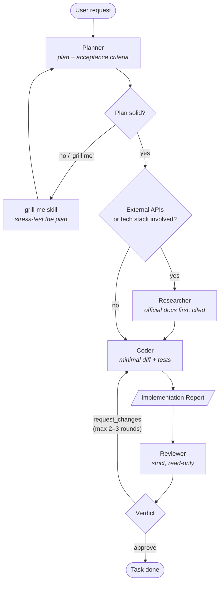

# Pi Harness Environment

A reusable Pi configuration that turns a project into a **multi-agent feature workflow**: planner → researcher → coder → reviewer. Drop the `.pi` directory into any repo and Pi sessions will follow the pipeline defined here.

## Repository layout

```
.pi/
├── AGENTS.md                        # Workflow rules, read by every agent
├── agents/
│   ├── planner.md                   # Scope + implementation plan (read-only)
│   ├── researcher.md                # Docs-first research with citations (read-only)
│   ├── coder.md                     # Minimal-diff implementation + tests
│   └── reviewer.md                  # Strict post-implementation review
└── skills/
    ├── feature-pipeline/SKILL.md    # Runs the full pipeline end-to-end
    └── grill-me/SKILL.md            # Adversarially challenges a plan or design
```

## The workflow

For non-trivial features or bugfixes, work flows through specialized subagents instead of one generalist. Each step passes a structured artifact (plan, research brief, implementation report) to the next.



**Rules enforced by `.pi/AGENTS.md`:**

- Prefer the specialized subagents over doing everything in one session.
- Pass structured artifacts between agents.
- On `request_changes`, findings go back to the coder for at most 2–3 rounds.
- A task is only done when the reviewer verdict is `approve` (or the user overrides).

## Agents

| Agent | Role | Tools | Model / thinking |
|---|---|---|---|
| `planner` | Understands the request, produces a minimal plan with acceptance criteria and out-of-scope items. Never edits files. | read-only + bash | `deepseek-v4.1-flash`, thinking: medium |
| `researcher` | Answers open questions from official docs first, web search only as fallback. Always cites sources, never invents APIs. Returns a research brief. | read-only + bash | thinking: low |
| `coder` | Implements the smallest change that satisfies the plan, follows existing patterns, adds/updates tests, runs them (max 3 fix attempts). No scope creep. Returns an implementation report. | full (write/edit/bash) | thinking: medium |
| `reviewer` | Stricter than the implementer. Reviews correctness, plan compliance, test quality, security, maintainability, and simplicity. File + line specific. Read-only. Returns a verdict. | read-only + bash | thinking: high |

## Skills

| Skill | When to use |
|---|---|
| `feature-pipeline` | Run the complete planner → researcher → coder → reviewer flow for a feature request. |
| `grill-me` | After planning, or whenever a plan feels weak. A skeptical senior engineer lists wrong assumptions, missing edge cases, untestable acceptance criteria, and tighter scopes. |

## Usage

**In this repo:** open a Pi session here; agents and skills are picked up from `.pi/` automatically. Ask for a non-trivial feature and the workflow applies.

**In another project:** copy (or symlink) the `.pi` directory into the project root:

```sh
cp -r /path/to/pi-harness-environment/.pi /path/to/your-project/.pi
```

Then prompt normally — e.g. *"Use the feature-pipeline for: add pagination to the users endpoint"* — or just say **"grill me"** to have your current plan challenged.
